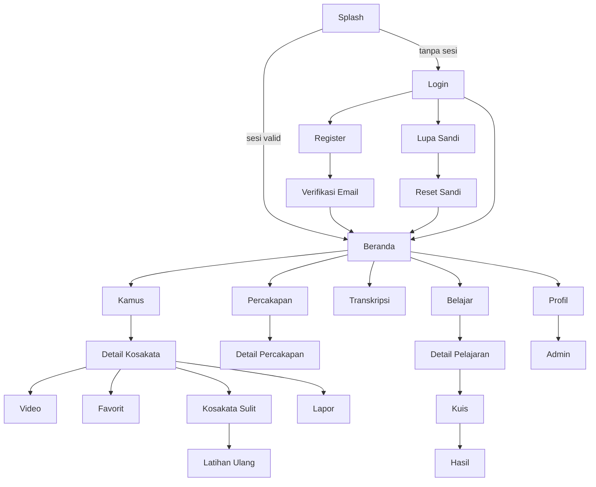

# USER_FLOWS — BISINDO

Notasi: `[Sxx]` = layar di `UI_UX_SPECIFICATION.md`. "✗" = jalur alternatif/gagal.

## F1. Buka aplikasi & pemulihan sesi
1. [S01] Inisialisasi Supabase, muat sesi tersimpan.
2. Sesi valid → `/home` [S07]. Sesi kedaluwarsa dan refresh berhasil → `/home`.
3. ✗ Tidak ada sesi / refresh gagal karena token ditolak → `/login` [S02] (tanpa pesan error bila sesi memang kosong; pesan "Sesi berakhir, silakan masuk lagi" bila token ditolak).
4. ✗ Offline dengan sesi lokal → `/home` dengan `OfflineBanner`; blok data menampilkan error+retry.
5. Selama aplikasi berjalan, event `signedOut` dari stream auth → arahkan ke `/login` dan hapus state.

## F2. Registrasi
1. [S02] Ketuk "Daftar" → [S03] isi 4 field → validasi klien.
2. Kirim → `signUp` dengan `full_name` pada metadata; trigger DB membuat `profiles` (role selalu `user`).
3. Verifikasi email aktif → [S06] → pengguna membuka tautan email → deep link `bisindo://auth-callback` → sesi aktif → [S07].
4. ✗ Email sudah terdaftar → pesan + tautan "Masuk". ✗ Sandi lemah / jaringan → pesan di §6 AUTH spec. ✗ Tautan kedaluwarsa → [S06] "Kirim Ulang".

## F3. Login
1. [S02] isi email+sandi → `signInWithPassword` → [S07].
2. ✗ Kredensial salah → banner "Email atau kata sandi salah." ✗ Email belum diverifikasi → aksi "Kirim ulang verifikasi". ✗ Rate limit/jaringan → pesan.

## F4. Lupa & reset sandi
1. [S02] "Lupa Kata Sandi?" → [S04] kirim email → pesan netral.
2. Email → tautan → deep link → [S05] sandi baru → `updateUser` → [S07].
3. ✗ Tautan kedaluwarsa → pesan + kembali ke [S04].

## F5. Mencari kosakata & menonton video
1. [S07]/tab Kamus → [S08] ketik kata (debounce) atau pilih kategori.
2. Daftar hasil → ketuk → [S09] (poster + teks).
3. Ketuk poster → [S10] memuat signed URL → buffering → putar; pengguna dapat pause/ulang/0.5×/fullscreen.
4. ✗ Tidak ada hasil → empty state. ✗ Jaringan gagal → error+retry. ✗ Video belum ada → placeholder. ✗ Pemutaran gagal/URL kedaluwarsa → "Coba Lagi" mengambil signed URL baru; bila file hilang (404) → "Video tidak ditemukan" + sarankan Laporkan.

## F6. Favorit
[S08]/[S09] ketuk hati → insert `favorites` (optimistik); ketuk lagi → delete. Gagal → rollback + snackbar. Daftar di [S19] (Profil → Favorit).

## F7. Menandai kosakata sulit & latihan ulang
1. [S09] "Tandai Sulit" → `upsert` (unik `user_id, sign_id`) → snackbar "Ditambahkan ke daftar sulit".
2. Ditandai lagi → tidak menggandakan (aksi berubah menjadi "Hapus dari daftar sulit").
3. [S20] daftar → [S21] latihan: putar video → "Tampilkan arti" → "Sudah paham" (`relearned`) / "Masih sulit".
4. Beranda [S07] menampilkan hingga 5 item `learning` untuk latihan cepat.
5. ✗ Kosakata sudah diarsipkan admin → item tampil "Materi tidak tersedia" dengan opsi hapus dari daftar.

## F8. Modul percakapan
[S11] pilih kategori → modul → [S12] baca konteks → putar tiap dialog/video → (opsional) tandai sulit → "Tandai selesai" → `user_progress` completed. Posisi terakhir tersimpan (`last_position`) saat keluar.

## F9. Transkripsi suara → teks
1. [S07] "Transkripsi" → [S13] baca banner.
2. Mulai → izin mikrofon (dialog penjelasan dulu) → mendengarkan → hasil sementara → Berhenti → teks final dapat diedit/disalin/dihapus.
3. ✗ Izin ditolak → penjelasan + "Buka Pengaturan". ✗ Tanpa internet/layanan tak tersedia → pesan sesuai. ✗ `error_no_match`/timeout → "Suara tidak terdengar jelas."
4. Keluar layar → teks dihapus dari memori (konfirmasi bila ada teks); mikrofon dihentikan.

## F10. Melaporkan konten
[S09/S12/S15] "Laporkan" → [S22] pilih kategori (+keterangan) → kirim `insert content_reports` (status `open`) → konfirmasi → [S23] melihat status.
✗ Duplikat terbuka → ditolak oleh indeks unik → pesan. ✗ >10 laporan/24 jam → pesan batas. ✗ Kategori "Lainnya" tanpa keterangan → validasi.

## F11. Belajar & kuis
1. [S14] → [S15] → buka item satu per satu (update `last_accessed_at`, `progress_percent`).
2. "Mulai Kuis" → [S16] jawab semua → "Selesai" → RPC `submit_quiz_attempt` → [S17] hasil + tinjauan.
3. Lulus (≥ `pass_score_percent`) → pelajaran otomatis `completed`.
4. ✗ Jaringan gagal saat submit → jawaban tetap, tombol "Kirim Ulang". ✗ Kuis dinonaktifkan/diarsipkan → "Kuis tidak tersedia".
5. Riwayat percobaan di [S17]/[S18].

## F12. Admin mengelola & menerbitkan konten
1. Admin login → [S24] menu Admin → [S25].
2. Buat entri (status `draft`) → isi teks → unggah video (validasi lokal → upload → catat `media_assets` → hubungkan) → status `in_review`.
3. Validator manusia memeriksa → admin mengisi validator/tanggal/sumber → status `verified` → `published`.
4. ✗ Menerbitkan tanpa data validasi → ditolak CHECK DB → pesan terjemahan. ✗ Unggah gagal/putus → ulangi, objek yatim dibersihkan. ✗ Bukan admin → ditolak RLS (UI hanya lapisan kenyamanan).
5. Penggantian video: unggah aset baru → hubungkan → hapus aset lama (lihat SECURITY §6).

## F13. Admin meninjau laporan
[S25] → [S27] → pilih laporan → buka materi → ubah status (`in_review`/`resolved`/`rejected`) + `resolution_message` → pengguna melihat di [S23].

## F14. Logout
[S24] "Keluar" → dialog → `signOut` → bersihkan provider/cache → [S02]. ✗ Gagal jaringan → sesi lokal tetap dihapus; lanjut ke Login.

## Diagram ringkas (Mermaid)

